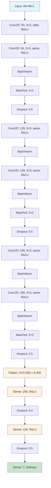
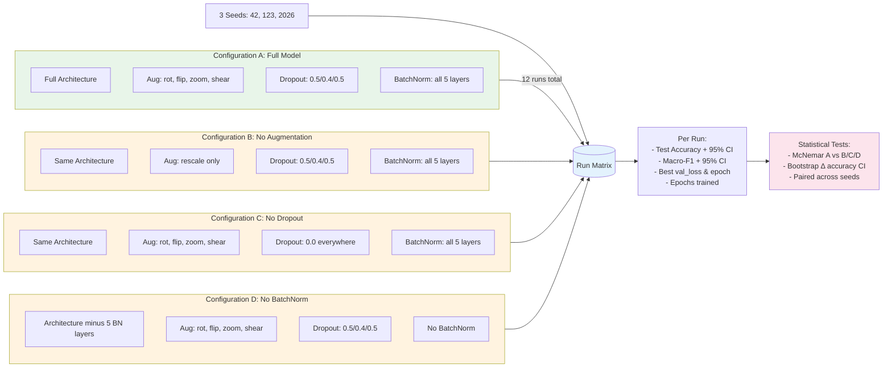
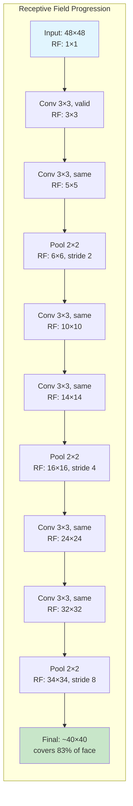
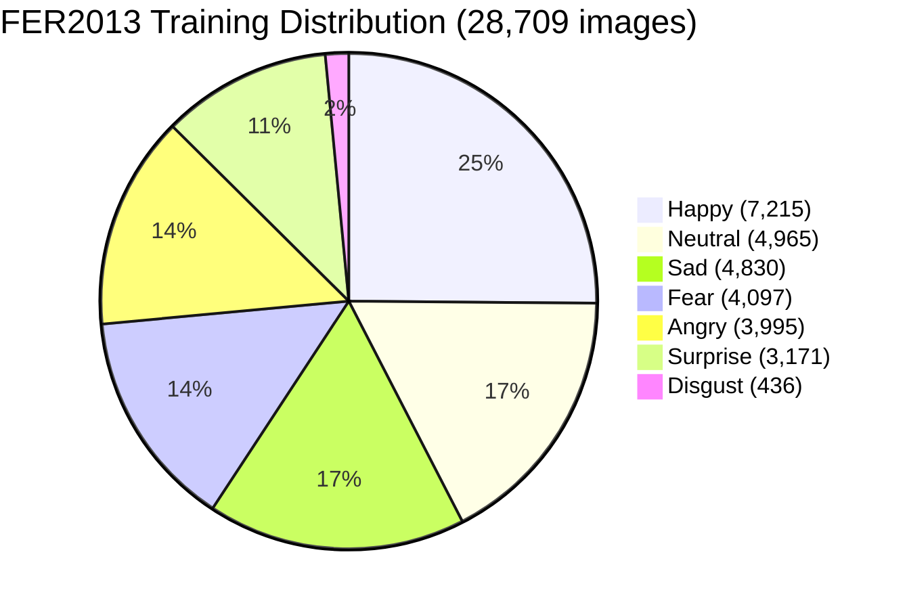
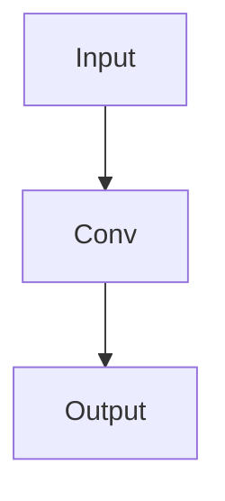

# Diagrams for FER Thesis
**Mermaid diagrams — render in any Markdown viewer with Mermaid support**

---

## 1. CNN Architecture Diagram


**Layer Summary Table:**

| Block | Layers | Output Shape | Parameters |
|-------|--------|--------------|------------|
| **Input** | — | 48×48×1 | 0 |
| **Block 1** | Conv(64,3×3,valid) → Conv(64,3×3,same) → BN → MaxPool → Dropout(0.5) | 23×23×64 | 37,696 |
| **Block 2** | Conv(128,3×3,same) → BN → Conv(128,3×3,same) → BN → MaxPool → Dropout(0.5) | 11×11×128 | 221,952 |
| **Block 3** | Conv(256,3×3,same) → BN → Conv(256,3×3,same) → BN → MaxPool → Dropout(0.5) | 5×5×256 | 886,336 |
| **Classifier** | Flatten → Dense(256) → Dropout(0.4) → Dense(128) → Dropout(0.5) → Dense(7) | 7 | 1,672,391 |
| **Total** | 23 layers | — | **2,818,375** |

---

## 2. End-to-End Pipeline Flowchart
```mermaid
flowchart TD
    subgraph DATA["Data Preparation"]
        D1[fer2013.csv\n35,887 rows]
        D2[Parse pixel strings\n2,304 → 48×48×1]
        D3[One-hot encode labels\n7 classes]
        D4[Split by Usage column]
    end
    
    subgraph SPLITS["Leakage-Free Splits"]
        S1[Training: 28,709\nUsage=Training]
        S2[Validation: 2,871\n10% stratified from Training]
        S3[Test: 7,178\nPublicTest + PrivateTest\nOPENED ONCE ONLY]
    end
    
    subgraph TRAIN["Training Pipeline"]
        T1[Data Generator\nAugmentation: rot±20°, flip, zoom±20%, shear]
        T2[Validation Generator\nRescale only]
        T3[CNN Model\n3 blocks + classifier head]
        T4[Adam, CE loss, batch=64]
        T5[Callbacks:\n- ReduceLROnPlateau (factor=0.8, patience=3)\n- EarlyStopping (patience=6)\n- ModelCheckpoint (best val_loss)]
    end
    
    subgraph EVAL["Evaluation Protocol"]
        E1[Load best checkpoint]
        E2[Predict on test set\nonce, no retraining]
        E3[Metrics: Accuracy, Macro-F1,\nPer-class P/R/F1, Confusion Matrix]
        E4[Bootstrap 95% CI\nMcNemar paired tests]
        E5[Compare to baselines:\nRandom 14.3%, Majority 24.7%]
    end
    
    subgraph DEMO["Live Demo"]
        M1[Webcam capture]
        M2[Haar cascade detection]
        M3[Crop → resize 48×48 → normalize]
        M4[Model prediction]
        M5[Overlay label on frame]
    end
    
    D1 --> D2 --> D3 --> D4
    D4 --> S1
    D4 -.->|MERGED in\noriginal code| S3
    S1 -->|90/10 stratified| S2
    S1 --> T1
    S2 --> T2
    T1 & T2 --> T3
    T3 --> T4 --> T5
    T5 -->|Best checkpoint| E1
    S3 -.->|NEVER used\nduring training| E1
    E1 --> E2 --> E3 --> E4 --> E5
    T5 -->|Saved .keras| M1
    M1 --> M2 --> M3 --> M4 --> M5
    
    style S3 fill:#ffcdd2
    style E1 fill:#c8e6c9
    style T5 fill:#fff3e0
```

---

## 3. Ablation Study Design


**Run Matrix (12 runs):**

| Config | Description | Seeds | Priority |
|--------|-------------|-------|----------|
| A | Full model | 42, 123, 2026 | 1 (baseline) |
| B | No augmentation | 42, 123, 2026 | 2 (biggest expected effect) |
| C | No dropout | 42, 123, 2026 | 3 |
| D | No batch norm | 42, 123, 2026 | 4 |

---

## 4. Deployment Gap: Benchmark vs. Webcam
```mermaid
flowchart LR
    subgraph BENCH["Benchmark Setting (FER2013)"]
        B1[48×48 tight crop\nFace centered, ~80% of frame]
        B2[Grayscale, normalized [0,1]]
        B3[Fixed pose: near-frontal]
        B4[Controlled lighting\n(in dataset collection)]
        B5[No temporal context\nsingle frame classification]
    end
    
    subgraph WEBCAM["Webcam Demo Setting"]
        W1[Detector rectangle\nLoose: hair, bg, shoulders]
        W2[Resize detector crop → 48×48\nFace SMALLER than training]
        W3[Color → grayscale conversion]
        W4[Variable lighting:\nbacklit, dim, color cast]
        W5[Unconstrained pose:\nprofile, tilt, occlusion]
        W6[Temporal flicker:\nframe-by-frame independent]
    end
    
    subgraph SHIFTS["Four Distribution Shifts"]
        SF1[Framing Shift\nDetector includes non-face regions]
        SF2[Illumination Shift\nWebcam ≠ dataset lighting]
        SF3[Geometry Shift\nNo alignment, rotation, profile]
        SF4[Temporal Shift\nNo smoothing, single-frame]
    end
    
    subgraph FIXES["Proposed Mitigations"]
        FX1[Landmark detection\nMTCNN / RetinaFace / MediaPipe]
        FX2[Histogram equalization\nor CLAHE pre-processing]
        FX3[Landmark-based alignment\nSimilarity transform]
        FX4[Temporal smoothing\nEMA or majority vote window]
    end
    
    BENCH -->|Ideal input| MODEL[CNN Classifier]
    WEBCAM -->|Actual input| MODEL
    BENCH -.->|Training distribution| MODEL
    WEBCAM -.->|Test distribution| MODEL
    
    BENCH --> SHIFTS
    WEBCAM --> SHIFTS
    SHIFTS --> FIXES
    
    style BENCH fill:#e8f5e9
    style WEBCAM fill:#ffcdd2
    style SHIFTS fill:#fff3e0
    style FIXES fill:#e3f2fd
```

**Quantifying the Framing Shift:**

```
FER2013 Training Crop:          Webcam Detector Crop:
┌─────────────────────┐         ┌─────────────────────┐
│  👤  FACE 80%      │         │  👤  FACE 40%       │
│   (centered)       │         │  👔  SHOULDER 20%   │
│                   │         │  🌲  BACKGROUND 40% │
└─────────────────────┘         └─────────────────────┘
       ↓ resize 48×48                ↓ resize 48×48
┌─────────────────────┐         ┌─────────────────────┐
│  FACE fills frame  │         │  FACE is SMALL      │
│  Features clear    │         │  Features BLURRED   │
└─────────────────────┘         └─────────────────────┘
```

---

## 5. Receptive Field Growth (Visual)


---

## 6. Class Imbalance Visualization


**Imbalance Ratio:** Happy : Disgust = **16.5 : 1**

---

## How to Embed in Thesis

### Option 1: Mermaid (renders in GitHub, GitLab, VS Code, Obsidian, Notion)
```markdown

```

### Option 2: Static Images (for PDF)
Export from Mermaid Live Editor (https://mermaid.live) → Save as SVG/PNG → Include in LaTeX/Word.

### Option 3: ASCII Fallback (already in chapters)
The current chapters use ASCII diagrams that work everywhere.

---

## Diagram Checklist for Thesis

- [x] Architecture diagram (Ch 3)
- [x] Pipeline flowchart (Ch 3)
- [x] Ablation design (Ch 5)
- [x] Deployment gap (Ch 3/6)
- [x] Receptive field growth (Ch 3)
- [x] Class imbalance (Ch 2/3)
- [ ] Training curves (Ch 5 - needs actual runs)
- [ ] Confusion matrix (Ch 5 - needs actual runs)
- [ ] Ablation box plots (Ch 5 - needs actual runs)